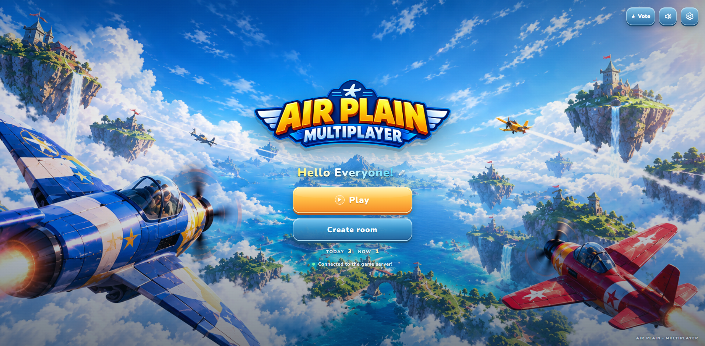

  

<h1 align="center">Air Plain Multiplayer</h1>

  <strong>Climb in. Pick a side. Light up the sky.</strong> 
  A realtime dogfight in the browser. Rockets, mines, teams, and a world full of other pilots.

  <a href="https://node-air-craft-multiplayer-game-v2.vercel.app"><strong>▶ Play now</strong></a>

  

<em>One sky. Every pilot on the map. Your team in its own color.</em>

## What you fly

- **Drop straight into a match**, or open a private room and send the link.
- **Team A, Team B, solo, or your own squad.** Teammates show up in the team color, on the name and on the world map.
- **Rockets, mines, and a fast boost.** Level up, climb the ranking, and keep the plane in the air.
- **A world map that stays readable** while you fly underneath it.

## Run locally

1. Install Node.js (LTS).
2. From this directory, run `npm install` once.
3. Run `npm run dev`.
4. Open the Vite URL printed in the terminal (usually `http://localhost:5173`).

The React client connects to `ws://localhost:3001/ws`. Set `VITE_WEBSOCKET_URL` in a client `.env` file to use a different WebSocket URL.

## Production

1. Run `npm run build`. That writes the release client to `client/dist` and copies it to `public/` for Vercel.
2. Run `npm start`. The server listens on `PORT` (3001 locally), serves `client/dist`, and accepts the game socket at `/ws`.
3. Open `http://localhost:3001`.

## Vercel

Import this folder as a Vercel project. The project Root Directory must be this folder, the one that contains `api/` and `vercel.json`, not `client`. The page connects to `/api/server`. The browser reconnects if that socket closes.

Vercel pins each socket to one function instance and closes it at the plan duration limit (300 seconds on Hobby). A long-running `npm start` host keeps every player in one world. Set `VITE_WEBSOCKET_URL` at build time when the page and the socket are on different hosts.

## Project layout

- `server/src/` — WebSocket server, rooms, teams, and combat.
- `client/src/` — React flight view, menu, and network client.
- `client/public/assets/` — images, audio, and other static game assets.
- `docs/` — the menu still and the flight clip used above.
